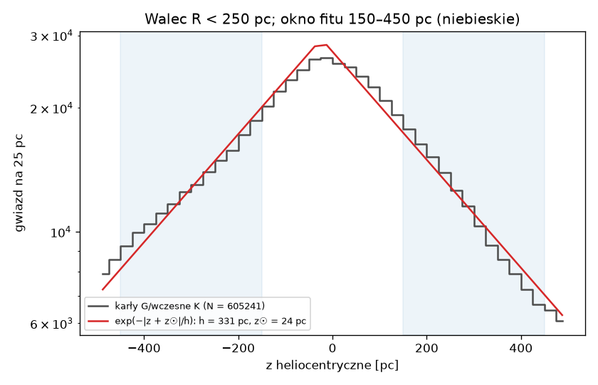

# Jak mierzymy grubość dysku — po ludzku

Ten dokument opisuje drugą część kamienia milowego M5: orientacyjny pomiar
**wysokości skali** dysku Galaktyki z gwiazd w naszym katalogu. Kod:
`milkyway/scale_height.py`, polecenie
`python MilkyWay.py --dataset dr3_g15_p0.5_v3 --scale-height docs/data`.
Wynik: `docs/data/scale_height.json` i `docs/data/scale_height.png`.
Decyzja: D-025 (metoda: plan 1.0 §4, D-014). Liczby policzone na naszych
danych 31.10.2026.

---

## 1. Co to jest wysokość skali

Dysk Drogi Mlecznej jest płaski jak naleśnik: ma ~30 kpc średnicy, ale
gwiazdy skupiają się blisko płaszczyzny. Im wyżej nad nią (albo niżej),
tym gwiazd mniej. W najprostszym modelu gęstość spada **wykładniczo**:

  n(z) ∝ exp(−|z| / h)

**h** to wysokość skali: o tyle trzeba się wznieść, żeby gwiazd było
e ≈ 2,72 razy mniej. Jeśli h = 300 pc, to 300 pc nad płaszczyzną jest
2,7× mniej gwiazd, a 600 pc nad nią 7,4× mniej.

**Analogia:** to jak gęstość powietrza z wysokością. Wysokość skali
atmosfery to ~8 km, a dysku gwiazd kilkaset parseków.

## 2. Dlaczego „orientacyjnie”

Prawdziwy pomiar (plan v4, S5) wymaga fitu w przestrzeni paralaks,
symulacji, rozdzielenia dysku cienkiego i grubego i budżetu błędów.
W Mapie 1.0 robimy prosty fit, żeby sprawdzić, czy dane mają sens, i zobaczyć
rząd wielkości. Cel planu: wynik w przedziale **200–450 pc**.

## 3. Jakie gwiazdy bierzemy i dlaczego

Bierzemy **walec** o promieniu 250 pc wokół Słońca, do |z| = 500 pc
(1 821 484 gwiazd), a z niego **karły G i wczesne K**:

- kolor po odjęciu pyłu 0,70 ≤ BP−RP₀ < 1,10 (od ~6200 K do ~5100 K;
  Słońce ma 0,82);
- jasność absolutna po odjęciu pyłu M_G₀ ≤ 6;
- najwyżej 1 mag od ciągu głównego, czyli bez podolbrzymów i olbrzymów.

Wychodzi **605 241 gwiazd**.

**Dlaczego M_G ≤ 6 (D-014).** Katalog ma tylko gwiazdy jaśniejsze niż
G = 15. Najdalszy punkt walca leży √(250² + 450²) ≈ 515 pc od nas.
Gwiazda M_G = 6 ma tam G = 6 + 8,56 + A_G ≈ 14,6–15. Słabsze karły
znikałyby z próbki tym bardziej, im wyżej leżą, i udawałyby spadek
gęstości. Sprawdzamy to na danych: najsłabsza gwiazda próbki ma
G = **14,79**, a tylko 0,16% ma G > 14,5. Próbka jest kompletna.

**Dlaczego pył się liczy.** Bez korekty (D-024) gwiazdy za pyłem
wyglądałyby słabiej i czerwieniej. W walcu pył jest mały (mediana
A_G = 0,04 mag), ale przy płaszczyźnie 1% gwiazd ma A_G > 0,77 mag.

**Dlaczego nie gorętsze gwiazdy.** Gwiazdy A i B są młode i nie zdążyły
się „rozbujać” w pionie. Ich h to ~100 pc, więc zaniżyłyby wynik.
Karły G i K mają po kilka miliardów lat, jak przeciętny dysk.

## 4. Jak dopasowujemy

Model: n(z) ∝ exp(−|z + z☉| / h), gdzie z to wysokość względem Słońca.
Drugi parametr, **z☉**, to wysokość Słońca nad płaszczyzną. Słońce nie
siedzi dokładnie w środku dysku, więc płaszczyzna leży u nas na z = −z☉.

Dopasowujemy tylko gwiazdy w oknach **150 < |z| < 450 pc** po obu stronach.
Blisko płaszczyzny profil nie jest wykładniczy, tylko zaokrąglony (widać
to na wykresie). Wyżej zaczyna przeważać dysk gruby.

Metoda: największa wiarygodność na pojedynczych gwiazdach, bez
histogramu. Kształt rozkładu w każdym oknie mówi, ile wynosi h.
Stosunek liczby gwiazd na północy i na południu mówi, ile wynosi z☉:
na północy jest ich mniej, bo Słońce jest wyżej, więc północne okno
leży dalej od płaszczyzny.

Na danych syntetycznych (h = 300, z☉ = 20) fit oddaje h = 298 ± 4
i z☉ = 18,8 ± 1,1 pc.

## 5. Wynik



**h ≈ 331 pc (orientacyjnie), z☉ ≈ 24 pc.**

Błąd statystyczny jest mały (±2,4 pc), bo gwiazd jest dużo. Ważniejsze
jest, jak wynik zmienia się z wyborami, których nikt nie narzucił:

| Wariant | h [pc] | z☉ [pc] |
|---|---|---|
| **główny** (okno 150–450, BP−RP₀ 0,70–1,10, M_G₀ ≤ 6) | **331,0** | **23,7** |
| okno 100–400 pc | 322,0 | 16,7 |
| okno 200–500 pc | 342,4 | 31,6 |
| z☉ ustalone na 20,8 pc | 328,4 | (20,8) |
| tylko karły G (0,70–0,90) | 342,3 | 23,8 |
| tylko wczesne K (0,90–1,10) | 316,4 | 23,6 |
| walec R < 150 pc | 329,1 | 22,9 |
| M_G₀ ≤ 5 | 330,4 | 23,6 |
| bez korekty pyłu | 337,7 | 22,7 |

Rozrzut wariantów: **316–342 pc**. W celu planu (200–450) mieścimy
się z zapasem. Literatura dla porównania: Jurić i in. 2008 ~300 pc dla
cienkiego dysku, Bennett & Bovy 2019 z☉ = 20,8 pc. Bez korekty pyłu
wychodzi o ~7 pc więcej.

**Wyższe okno daje większe h** (322 → 331 → 342). To ślad dysku
grubego: im wyżej, tym większy udział gwiazd o h ~1 kpc, które w prostym
modelu z jednym wykładnikiem „rozciągają” wynik. Stąd też h jest
większe dla karłów G niż K: w oknie G jest więcej starszych gwiazd.

## 6. Niespodzianka: północ ≠ południe

Gdy dopasujemy każdą stronę osobno (z☉ = 20,8 pc), wychodzi:

- **północ: h = 274 pc** (137 384 gwiazd w oknie),
- **południe: h = 403 pc** (158 552 gwiazd).

Na wykresie widać to gołym okiem: po prawej (północ) punkty są nad
modelem przy 100–250 pc i pod nim przy 350–450 pc, po lewej daleki ogon
leży nad modelem. Fit „po obu stronach” uśrednia to i część różnicy
wkłada w z☉. Dlatego z☉ tak skacze z oknem (17–32 pc).

To nie wina pyłu (fit bez korekty daje podobny obraz) ani kompletności
(G < 14,8 wszędzie). Asymetrię północ–południe w liczbach gwiazd przy
Słońcu opisano już w literaturze (np. Widrow i in. 2012, Bennett & Bovy
2019) i tłumaczy się ją pionowymi „falami” w dysku, wzbudzonymi np. przez
przejście galaktyki karłowatej w Strzelcu. W Mapie 1.0 tego nie
modelujemy. To dobry powód, żeby wynik nazywać orientacyjnym.

## 7. Skutki uboczne, o których trzeba pamiętać

- **Jeden wykładnik** to uproszczenie: dysk cienki i gruby się mieszają
  (h rośnie z oknem).
- **z☉ z symetrii** jest wątpliwe przy tej asymetrii. Wartość 23,7 pc to
  raczej „parametr fitu” niż pomiar wysokości Słońca.
- **Odległości z inwersji paralaksy.** Przy ~500 pc i G < 15 paralaksa
  ma błąd ~1%, więc to tu nieistotne, ale plan v4 robi fit w paralaksach.
- **Grzbiet ciągu głównego** (`classify._MS_*`) pochodzi z próbki 60 pc
  i nie uwzględnia metaliczności. Uboższe w metale karły dysku grubego
  leżą trochę pod nim. Okno ±1 mag jest szerokie, więc to drobne.
- **Pył**: mapa ma rozdzielczość ~0,23° i parseki, korekta jest średnią
  (D-024).

## 8. Jak to odtworzyć

```powershell
python MilkyWay.py --dataset dr3_g15_p0.5_v3 --scale-height docs/data
```

Potrzebny katalog zbudowany z mapą pyłu (`--build` bez `--no-dust`).
Polecenie odmawia pracy na katalogu bez pyłu.

## 9. Słowniczek

- **Wysokość skali (h)** — odległość od płaszczyzny, na której gęstość
  spada e ≈ 2,72 razy.
- **z☉** — wysokość Słońca nad płaszczyzną Galaktyki (~20 pc, na północ).
- **Dysk cienki / gruby** — dwie populacje: młodsza i bogata w metale
  (h ~300 pc) oraz starsza, uboższa (h ~1 kpc).
- **Największa wiarygodność** — wybieramy parametry, przy których
  obserwowane dane są najbardziej prawdopodobne.
- **Kompletność** — czy w próbce są *wszystkie* gwiazdy danego typu
  w objętości, a nie tylko te, które akurat przeszły limit jasności.
- **Karzeł G/K** — gwiazda ciągu głównego jak Słońce (G) albo trochę
  chłodniejsza (K).
- **Galaktyka karłowata w Strzelcu** — mała galaktyka pochłaniana przez
  Drogę Mleczną; jej przejścia przez dysk mogły go „rozkołysać”.
